  

  
  
  
  
  

## 👋 About me

I'm **Nirob Islam** (মো. নুরুন্নবী ইসলাম নিরব), known as **Niru Bhai**, from Bogura, Bangladesh.
I build websites and web apps, and I've spent **8+ years** editing video and designing motion graphics.
I like work where a designer's eye and clean code meet: fast, simple sites that people actually enjoy using.

- 🛠️ Building fast, clean websites and web apps that work great on mobile
- 🎬 Editing video and motion graphics in **Premiere Pro, After Effects and Photoshop**
- 🤝 Working with **[Life Review Team](https://lifereview.team)** and **Expert Studio**, Bogura
- 🌐 Writing in **Bangla and English**, building for Bangla-speaking users first

## 🚀 Featured projects

<table>
  <tr>
    <td width="50%" valign="top">
      <h3><a href="https://www.smoron.org">স্মরণ · Smoron</a></h3>
      
An open, free memorial and obituary archive for Bangladesh. Families create a permanent memorial page with a unique ID; searchable by name, parent's name, district or ID.

      
Verified memorial pages · search by district · downloadable memorial cards · light a candle in tribute

      
<a href="https://www.smoron.org">smoron.org ↗</a> · <a href="https://www.nirobislam.com/blog/smoron-memorial-archive">Case study</a>

    </td>
    <td width="50%" valign="top">
      <h3><a href="https://www.nirobislam.com">nirobislam.com</a></h3>
      
My bilingual (বাংলা / English) portfolio and blog, where I share the apps and websites I build and the things I write.

      
Projects and writing in two languages · fast on mobile · easy to update from anywhere

      
<a href="https://www.nirobislam.com">nirobislam.com ↗</a> · <a href="https://www.nirobislam.com/blog">Blog</a>

    </td>
  </tr>
</table>

More projects and writing: **[nirobislam.com/blog](https://www.nirobislam.com/blog?type=project)**

## 🧰 Tools I use

**Web**

  
  
  
  

**Video & design**

  
  
  
  

## 📫 Let's work together

Need a website, a web app, or a video that tells your story?
Email **[nurunnabiislamniroob@gmail.com](mailto:nurunnabiislamniroob@gmail.com)** or visit **[nirobislam.com](https://www.nirobislam.com/#contact)**.

Made with ❤️ in Bogura, Bangladesh

